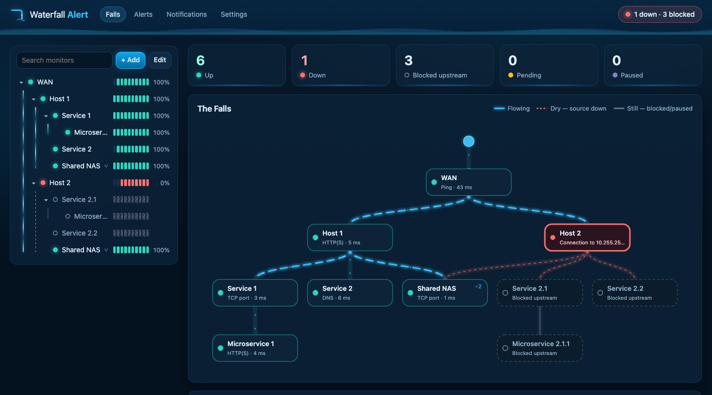

# Waterfall Alert

Hierarchical uptime monitoring for Home Assistant, or on its own with Docker. It's as simple as Uptime Kuma, except it understands that **when the WAN is down, you don't need twenty alerts.**

Monitors form a hierarchy, like folders. Checks run top-down: if `Host 2` is unreachable, nothing beneath it gets checked, and you get **one** alert:

```
Alert: Host 2 is unreachable

Host 2 is unreachable.

Target: 192.168.1.20:22
Reason: Connection to 192.168.1.20:22 timed out
Time: Nov 5, 2026, 3:23:28 PM

Other affected monitors (3):
- Service 2.1
-- Microservice 2.1.1
- Service 2.2
```



## Features

- **Hierarchical, root-cause alerting.** A monitor is only checked when its parents are up. When something fails, its parents are re-checked first, so the alert always names the highest failing monitor.
- **Multiple parents.** A monitor can depend on several parents. Choose whether it's blocked when *any* parent is down (it depends on all of them) or only when *every* parent is down (redundant paths, e.g. two WAN links).
- **Parents and dependents stay in sync.** Add a parent to a monitor and it shows up as that parent's dependent automatically, and the reverse works too.
- **Edit mode.** Drag a monitor onto another to nest it. Hold <kbd>Alt</kbd>/<kbd>⌥</kbd> to add an extra parent instead of moving it. On touch screens, use the move (⇅) button. Loops are rejected.
- **Recovery cascades downward.** When a monitor recovers you get a *Resolved* message, and the level beneath it is re-checked immediately, one level at a time.
- **Heartbeat history** like Uptime Kuma: heartbeat bars, a response-time chart (1h–30d), 24h/30d uptime, and an event log. Retention is configurable.
- **Monitor types:** HTTP(S) (status codes, keyword), TCP port, ping, DNS (including SRV), Home Assistant entity state, Minecraft Java server (follows SRV records, shows players), push (heartbeat URL), and group (a plain folder).
- **Notifications:** Home Assistant notify services, ntfy, Discord, Slack, Telegram, Pushover, Gotify, generic JSON webhook, email (SMTP).
- **Water-themed UI.** A live "falls" diagram where healthy streams flow with a blue glow, streams below a failure run dry, and blocked branches go still. Click a monitor to trace just its upstream and downstream, and expand it for a details panel.
- **Icons.** HTTP monitors show their site's favicon automatically. You can also choose a built-in icon, an emoji, an image URL or upload your own.
- **CSV import & export.** Move all your monitors to another install, or edit many at once in a spreadsheet. An export imports as it is. See the [CSV guide](docs/csv.md).
- **Tags.** Coloured tags on each monitor, a tag filter for the list and the falls, and bulk tagging: shift-click or drag a box over monitors in the falls, then add or remove tags, optionally including everything downstream.

## Install

Waterfall Alert runs as a Home Assistant add-on, or on its own on any machine with Docker.

### As a Home Assistant add-on

1. In Home Assistant go to **Settings → Add-ons → Add-on Store → ⋮ → Repositories**.
2. Add `https://github.com/big-barlowe/WaterfallAlert`.
3. Install **Waterfall Alert**, start it, and open **Waterfall** from the sidebar.

See [waterfall_alert/DOCS.md](waterfall_alert/DOCS.md) for configuration and usage details.

### With Docker (no Home Assistant needed)

```sh
git clone https://github.com/big-barlowe/WaterfallAlert.git
cd WaterfallAlert
docker compose up -d --build
```

Then open `http://<your-server>:8099`. Data is stored in `./data`. Every monitor type and notification channel works, except the two that talk to Home Assistant, which need a URL and access token if you want them.

> **There is no login.** Under Home Assistant, HA handles sign-in. Run on its own, anyone who can reach the port can use the app. Keep it on a trusted network, or put it behind a reverse proxy that adds authentication.

The **[Docker guide](docs/docker.md)** covers:
- a compose file that builds straight from GitHub, without cloning
- plain `docker run`
- configuration (time zone, connecting to Home Assistant)
- backups and updates
- a reverse proxy with a login
- networking (monitoring the Docker host itself, ping capabilities)
- moving between the add-on and Docker

## Development

Requires Node.js ≥ 22.13 (for the built-in `node:sqlite`).

```sh
cd waterfall_alert/app
npm install
npm start            # http://localhost:8099, data in ./data
npm test
```

No local Node? `docker compose up -d --build` from the repository root runs your working copy.

## License

MIT
